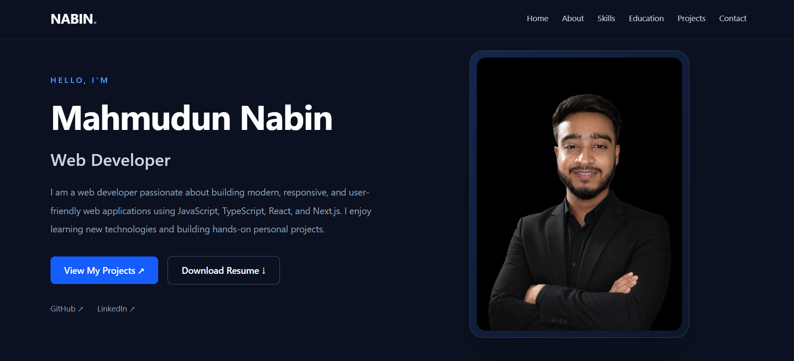

# Mahmudun Nabin — Personal Portfolio

A modern, responsive personal portfolio website showcasing my skills, projects, and journey as a Web Developer.

🌐 **Live Demo:** [Visit My Portfolio](https://my-portfolio-eight-livid-34.vercel.app/)

## 📌 Project Overview

This is my personal portfolio website, built to introduce myself as a Web Developer, showcase my technical skills and projects, and make it easy for recruiters, developers, and potential collaborators to connect with me.

The website highlights my background, web development journey, technical expertise, and hands-on projects using a clean and responsive user interface.

## 🖼️ Screenshot



## 🛠️ Tech Stack

The main technologies used in this project include:

- **Next.js** — React framework for building modern web applications
- **React** — Component-based user interface development
- **TypeScript** — Type-safe JavaScript development
- **Tailwind CSS** — Responsive and utility-first styling
- **JavaScript (ES6+)** — Modern JavaScript features
- **Vercel** — Hosting and deployment

## ✨ Key Features

- **Personal Introduction:** Introduces me and my journey as a Web Developer.
- **Responsive Design:** Adapts to desktop, tablet, and mobile screens.
- **About Me Section:** Shares my learning journey, background, and career goals.
- **Skills Showcase:** Highlights my technical skills and development tools.
- **Project Portfolio:** Displays selected projects with descriptions and relevant links.
- **Project Details:** Provides additional information about individual projects.
- **Resume Access:** Provides a way to view or download my resume when available.
- **Contact Information:** Makes it easier to reach me.
- **Social Links:** Connects visitors to my professional profiles.
- **Modern UI:** Uses reusable components and a clean visual layout.

## 📦 Dependencies

The following are the core packages and development tools expected in this project. Check `package.json` for the exact installed dependencies and versions.

| Package | Purpose |
|---|---|
| `next` | Next.js framework |
| `react` | Building UI components |
| `react-dom` | Rendering React components |
| `typescript` | Type checking and development |
| `tailwindcss` | Styling and responsive layouts |
| `eslint` | Code quality and linting |

Additional packages, such as icon libraries or animation libraries, may also be used if they are included in the project's `package.json`.

## 🚀 Getting Started

Follow these steps to run the project locally.

### Prerequisites

Make sure you have installed:

- [Node.js](https://nodejs.org/)
- npm (included with Node.js)
- [Git](https://git-scm.com/)

### 1. Clone the Repository

```bash
git clone https://github.com/nabin-90/my-portfolio.git
```

### 2. Navigate to the Project Directory

```bash
cd my-portfolio
```

### 3. Install Dependencies

```bash
npm install
```

### 4. Start the Development Server

```bash
npm run dev
```

### 5. Open the Website

Open your browser and visit:

```text
http://localhost:3000
```

The development server will automatically refresh the page when you make supported code changes.

## 📜 Available Scripts

| Command | Description |
|---|---|
| `npm run dev` | Starts the development server |
| `npm run build` | Creates an optimized production build |
| `npm run start` | Runs the production server after building |
| `npm run lint` | Runs ESLint, if configured in `package.json` |

## 🔗 Project Links

- **Live Portfolio:** [my-portfolio-eight-livid-34.vercel.app](https://my-portfolio-eight-livid-34.vercel.app/)
- **GitHub Repository:** [nabin-90/my-portfolio](https://github.com/nabin-90/my-portfolio)
- **GitHub Profile:** [github.com/nabin-90](https://github.com/nabin-90)
- **Bazar Dor:** [Live Demo](https://bazardor-self.vercel.app/) · [Source Code](https://github.com/nabin-90/bazar-dor)
- **FitLog:** [Live Demo](https://my-fitlog-app.vercel.app/) · [Source Code](https://github.com/nabin-90/fitlog)
- **Dev Stack:** [Live Demo](https://devstack-by-nabin.vercel.app/) · [Source Code](https://github.com/nabin-90/dev-stack)

## 🎯 Project Goals

- Showcase my web development skills and personal projects.
- Build a professional online presence.
- Practice modern frontend and full-stack development.
- Continuously improve my coding, UI design, and problem-solving skills.
- Connect with other developers and explore career opportunities.

## 👨‍💻 About Me

I'm Mahmudun Nabin, an aspiring Web Developer currently pursuing a Full Stack Web Engineering course at Programming Hero.

I'm passionate about learning modern web technologies and building responsive, user-friendly web applications. I enjoy improving my skills through practical projects and continuous learning.

## 📬 Contact

- **GitHub:** [nabin-90](https://github.com/nabin-90)
- **Portfolio:** [Visit Website](https://my-portfolio-eight-livid-34.vercel.app/)

---

⭐ If you find this project interesting, feel free to explore the repository and check out my other projects.

**Built with ❤️ by Mahmudun Nabin**
